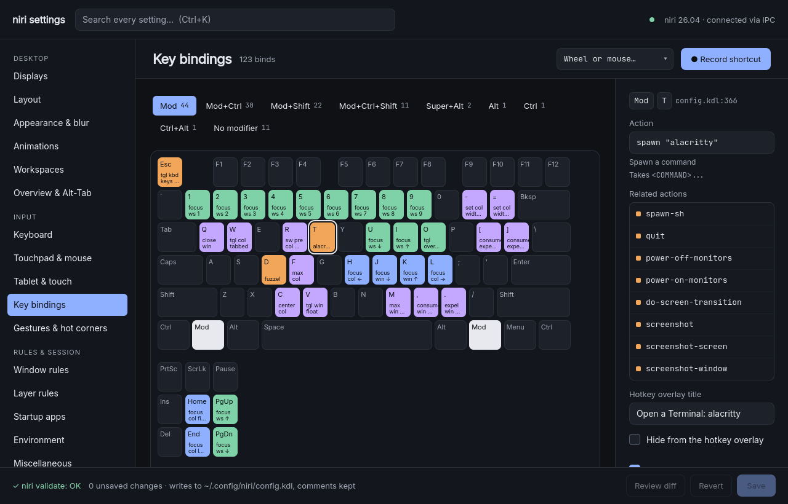
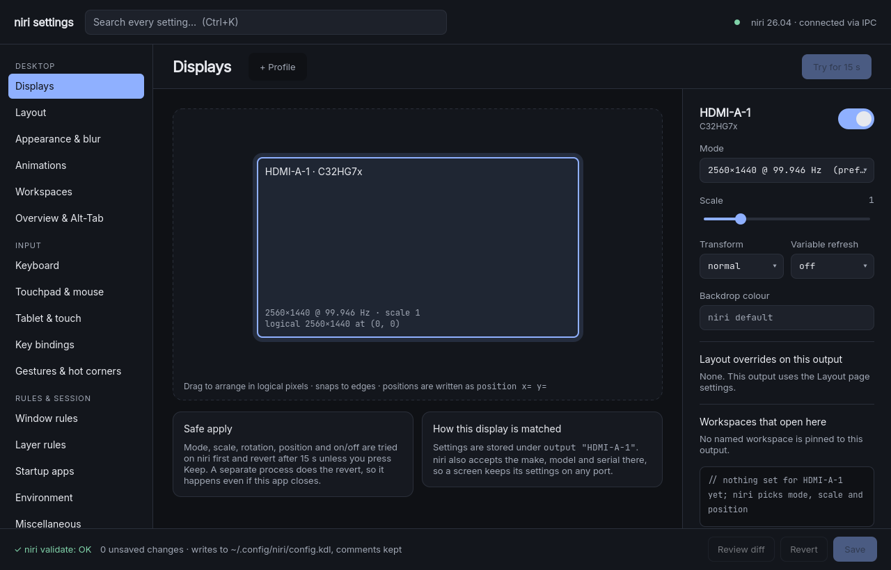
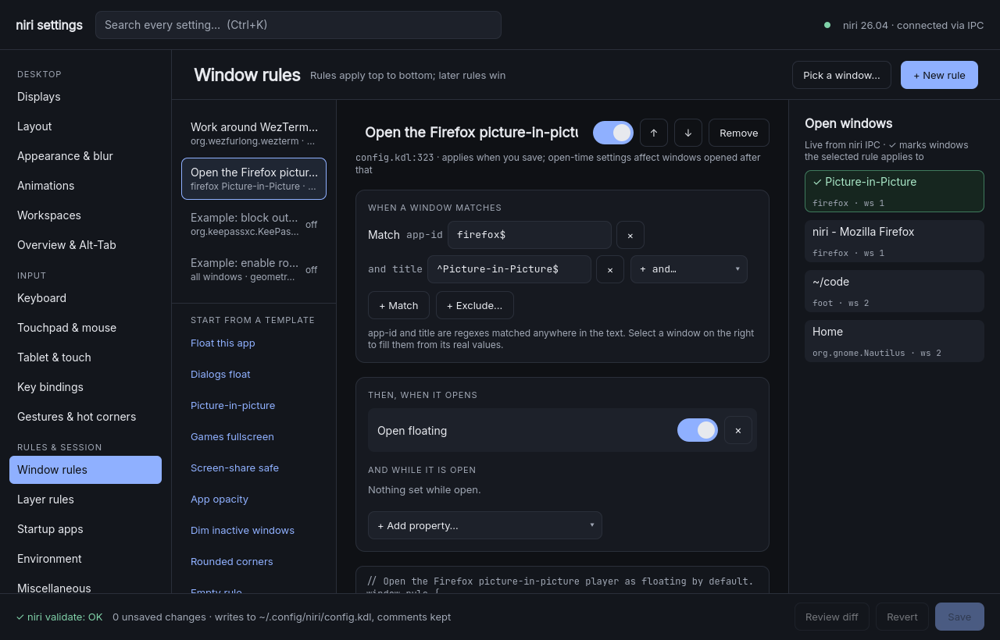
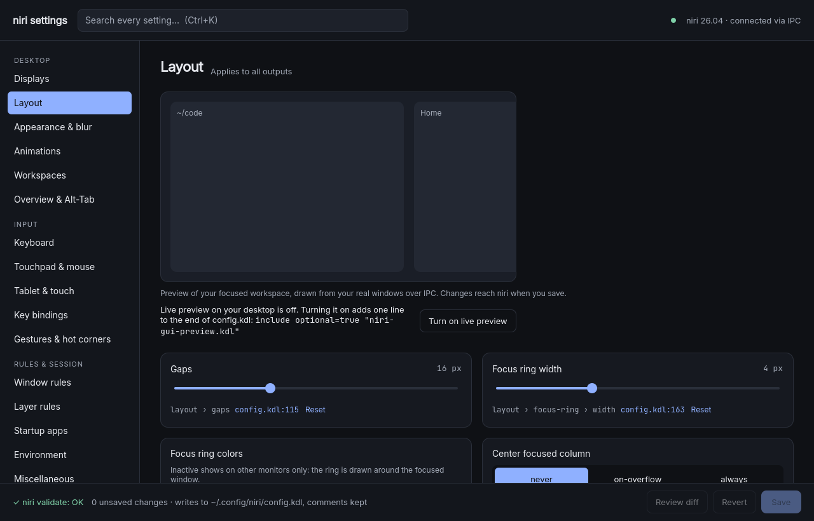

# niri settings

A settings app for the [niri](https://github.com/YaLTeR/niri) compositor. It edits your
KDL config in place, keeps comments and formatting, and never writes a file that
`niri validate` rejects.



| Displays | Window rules | Layout |
| --- | --- | --- |
|  |  |  |

## Install

**Fedora (RPM).** Every [release](https://github.com/joonaskit/niri-settings/releases)
has a ready-built noarch RPM, built and tested on Fedora 44. Install it with dnf, which
pulls in `niri`, `python3-pyside6`, `python3-regex` and `libxkbcommon`:

```
sudo dnf install https://github.com/joonaskit/niri-settings/releases/download/v0.1.0/niri-settings-0.1.0-1.fc44.noarch.rpm
```

or download the `.noarch.rpm` from the release page and run
`sudo dnf install ./niri-settings-*.noarch.rpm`. Then start **niri settings** from your
app launcher, or run `niri-settings`. To update, install the RPM of the newer release the
same way. A COPR repository with automatic updates is planned.

To build the RPM yourself, see `packaging/README.md`.

**Other distributions.** Each release also has a wheel. Install your distribution's
PySide6 and `regex` packages, then:

```
pip install --user niri_settings-0.1.0-py3-none-any.whl
```

This installs the `niri-settings` command, but no desktop entry or icon.

**From source**, with Python 3.11 or newer:

```
pip install --user .          # uses the system PySide6
pip install --user '.[pip]'   # or pulls PySide6 from PyPI
```

To run from a checkout without installing:

```
python3 -m niri_settings                      # edits $NIRI_CONFIG or ~/.config/niri/config.kdl
python3 -m niri_settings --config some.kdl    # edit another config tree
python3 -m niri_settings --offline            # do not talk to niri over IPC
python3 -m niri_settings --setup              # show the first-run choices again
```

## First run

The first time the app opens a config, it asks two things. Nothing is written until you
press Start.

- **How changes are written.** "Edit my files" (in-place) changes the file that sets each
  value. "Keep my files read-only" (managed) adds `include optional=true "niri-gui.kdl"` to
  config.kdl and writes only there. Managed is suggested when config.kdl is a symlink, in
  the Nix store or in a git repository.
- **Live preview.** Adds `include optional=true "niri-gui-preview.kdl"` as the last line,
  so unsaved changes show on the desktop.

Each include line is its own validated save, with a snapshot first. If config.kdl does not
exist yet, it is created from niri's default config (`/usr/share/doc/niri/default-config.kdl`)
before anything else, also when you press Skip. Both choices can be changed later on the
Config files page.

## Test

```
python3 -m unittest discover -s tests -t .
ruff check niri_settings tests
```

CI runs both on every pull request. `scripts/screenshots.py` re-renders the pictures in
`docs/screenshots/` (it needs a running niri and never touches your config). Releases are cut with `scripts/release.sh`; see
`packaging/README.md`.

## Displays

Mode, scale, rotation, position and on/off are never applied by saving alone. "Try for
15 s" sends them to niri with `niri msg output`, which does not touch the config, and
`niri_settings/output_guard.py` (a separate process) reverts them unless you press Keep. Save is
refused while there are display changes that have not been tried and kept.

## Key bindings

The map shows `binds {}` for one modifier layer at a time. Keys are placed with the xkb
keymap niri uses (the `xkb {}` section, else the system setting from `localectl`), read
through libxkbcommon; without the library a US layout is drawn. Binds with no key on the
map (media keys, wheel, mouse, or a key your layout does not have) are listed under it.

- A bind is edited as a whole node: `binds/Mod+T`. Only the changed part of its line is
  rewritten.
- Bind changes apply on save. They are never sent through the live-preview file.
- Removing or re-purposing your only `quit` bind or only terminal bind asks first.
- "Record shortcut" reads the key press from the window. niri handles its own shortcuts
  before the app sees them, and this Qt build has no shortcuts-inhibit support, so a
  combination niri already uses must be picked on the map instead.

## Settings pages

Most pages are drawn from `niri_settings/schema/pages.py`. Each setting has a kind (the control), a
config path, a label and niri's default. Each card shows where its value is set. That
`file:line` link opens the source editor at the line, and Reset removes the setting so
niri's default applies. The search box in the top bar covers every setting on every page.

Focus ring and border colours are on the Layout page, and tab colours on Appearance. Each
of active, inactive and urgent has a colour field and an optional gradient, edited like
the one in window rules. Clearing a colour field removes the colour so niri's default
applies. A gradient the editor cannot show (a fractional angle, an unknown colour space)
is listed as KDL with a link to the source. The layout preview draws the active ring and
border colours, using a gradient's start colour.

Every colour swatch, on the pages and in window rules, opens a colour picker:
a saturation/brightness square, hue and opacity bars, a few niri colours and a hex
field. Use writes `#rrggbb`, or `#rrggbbaa` when the colour is see-through.

Config files lists each top-level section of the config and the page that edits it.
`switch-events`, `debug` and `recent-windows › binds` are source-only for
now.

## Source editor

Config files has an editor for each file of the include tree.

- Text is checked as you type: what does not parse stays in the editor and is not taken.
  What parses becomes one unsaved change for that file, is validated with
  `niri validate` like any other change, and is written only by Save.
- The bar under the editor names the setting on the cursor's line and opens its page.
- In managed mode your own files are read-only here too.
- An outside edit to a file you are editing as text is a conflict, resolved in the
  banner like any other.

## Window rules

The page lists every `window-rule` in the order niri reads them, across include files. A
rule's name is the first line of the `//` comment right above it.

- Renaming changes only that first line; any explanation on the lines below stays.
- Clearing the name deletes the line when it is the whole comment. When more lines follow,
  it becomes a bare `//`, which means "no name", so the explanation is kept and does not
  turn into the name.
- A rule with no name is titled by its first app-id or title regex, or "All windows" when
  it matches everything.
- Leave a blank line between a section header comment and the first rule below it;
  otherwise the header is read as that rule's name.

- Rules are edited as a whole list. Each change splices only the lines that changed, so
  comments, raw-string regexes (`r#"…"#`) and one-line rules stay as written. A moved
  rule is written back exactly as it was.
- Rules commented out with `/-` (like the examples in niri's default config) are listed
  greyed out, in place. The switch next to the rule's name adds or removes the `/-`.
  niri skips such rules, so they never match a window, but they can still be edited.
  Startup commands get the same switch.
- With the live preview on, rule edits that only add are shown at once: the preview file
  gets rules that, read after all the others, give the same result. That covers a new
  rule, a rule turned on, and new or changed properties on a rule whose match lines stay
  the same, as long as no later rule sets the same property. Removals, moves, match
  edits and turning a rule off apply on save; the hint under the rule's name says which
  case an edit is in. Open-time properties affect windows opened after the preview.
- In managed mode, new rules go to `niri-gui.kdl` after your own. Changing, removing or
  inserting between your own rules needs in-place mode.
- The open windows come from niri IPC. Matching follows niri: any `match` line and no
  `exclude` line, with every matcher of a line holding. The app-id and title regexes are
  translated from Rust syntax and searched anywhere in the string.
- A matcher that IPC cannot answer (`at-startup`, `is-active-in-column` in a column with
  several windows) or a regex Python cannot reproduce (`\pL`, `(?i)` mid-pattern) gives
  "?" instead of a guess.
- Select a window to see which rules apply to it and the merged values. Later rules win,
  and the `focus-ring`, `border`, `shadow`, `tab-indicator`, `background-effect` and
  `popups` blocks merge child by child. "Pick a window…" uses `niri msg pick-window`.
- `open-on-output` and `open-on-workspace` offer names as you type: connected outputs
  from niri (connector, and make, model and serial), outputs named in the config, and
  named workspaces. A monitor with a serial is listed twice, by port and by make, model
  and serial, with a shared colour and a note on why. A name niri does not know gets a note, since niri then quietly opens
  the window on the usual output or workspace. Tablet and touch "Map to output" work the
  same way. Offline, unknown outputs are not flagged.
- A rule with no match that only sets focus ring or border looks points to the Layout
  page, which sets them for every window. A border or focus ring property notes when that
  block is off in the layout and the rule does not turn it on, since it then shows nothing.
- Gradients (`active-`, `inactive-` and `urgent-gradient` in `focus-ring`, `border` and
  `tab-indicator`) get from and to colours, a whole-degree angle, what they are relative
  to and the colour space they blend in. niri's defaults (angle 180, per window, srgb) are
  left out of the file. The preview strip blends in sRGB, so it is only close for other
  spaces. A colour in the same block says the gradient wins over it. A gradient with
  other props shows as KDL.

## Layer rules

The Layer rules page is the Window rules page for `layer-rule`, and edits the same way.

- It matches against the layer surfaces from `niri msg layers`, polled every two seconds
  while the page is open because niri does not stream them.
- Matchers are `namespace` (a regex, like app-id), `layer` (background, bottom, top or
  overlay) and `at-startup`. `at-startup` is judged by niri's age now, which assumes niri
  rechecks layer rules when its first minute ends (not yet tested against a nested niri).
- Every property applies continuously; there is nothing read only at open. `shadow`,
  `background-effect` and `popups` merge child by child.

## Layout

```
niri_settings/
  niri_core.py   load, merge and edit the KDL include tree (text splices, no re-serialising)
  config.py      pending changes, staged validation, snapshots, save, live-preview file
  ipc.py         niri socket requests and the event stream
  viewmodel.py   the one object QML talks to
  displays.py    outputs: drafts vs live state, the timed trial, profiles (no Qt)
  displays_view.py  the Displays page's object in QML
  output_guard.py   reverts a display trial even if the app dies
  keymap.py      xkb keymap (libxkbcommon via ctypes) and the physical key layout
  binds.py       key bindings: conflicts, edits, the lockout check (no Qt)
  binds_view.py  the Key bindings page's object in QML
  rules.py       window and layer rules: matching, merging, edits (no Qt)
  rules_view.py  the Window rules and Layer rules pages' objects in QML
  gradients.py   reading and writing niri gradients, for rules and the Layout page
  schema/        settings definitions that drive the forms (pages.py, layout.py);
                 the action catalogue; window- and layer-rule matchers, properties and templates
  qml/           Theme.qml (style tokens), shared controls, pages, the first-run dialog
  fonts/         Inter and JetBrains Mono (OFL), so the app looks the same everywhere
data/            desktop entry and AppStream metainfo
icons/           app icon: full size, a simpler one for 16–32 px, and a symbolic one
packaging/       the Fedora RPM spec and how to release (packaging/README.md)
.copr/Makefile   builds a source RPM for COPR from a git checkout
tests/
  corpus/        config trees used by the round-trip tests
```

## License

GPL-3.0-or-later (see `LICENSE`). The bundled fonts are under the SIL Open Font License
1.1 (`niri_settings/fonts/OFL.txt`).

## Safety net

- Every save is validated on a staged copy with `niri validate` first.
- The touched files are copied to `~/.local/state/niri-settings/snapshots/` before each
  save. Restore one from Config files; a restore is validated and snapshotted too.
- Write mode (Config files page): `in-place` edits the file that sets each value;
  `managed` leaves your files read-only and writes only to an included `niri-gui.kdl`.
- If a file changes on disk while you have unsaved changes, they are re-applied on top.
  A setting changed on both sides is shown as a conflict to resolve before saving.
